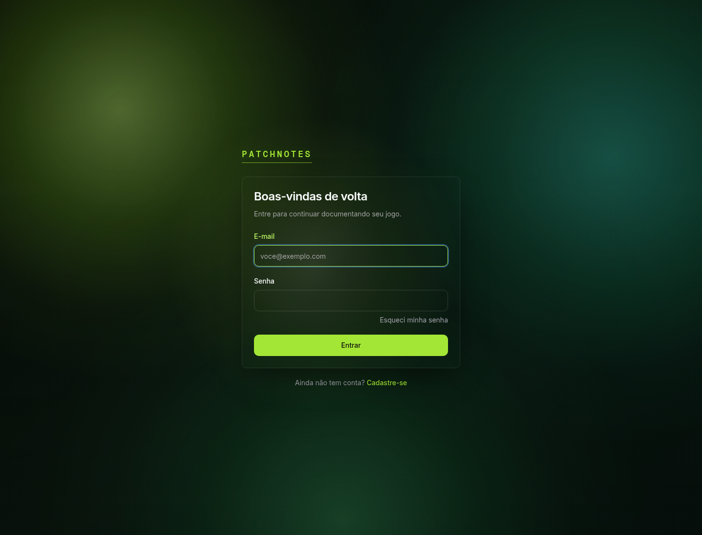
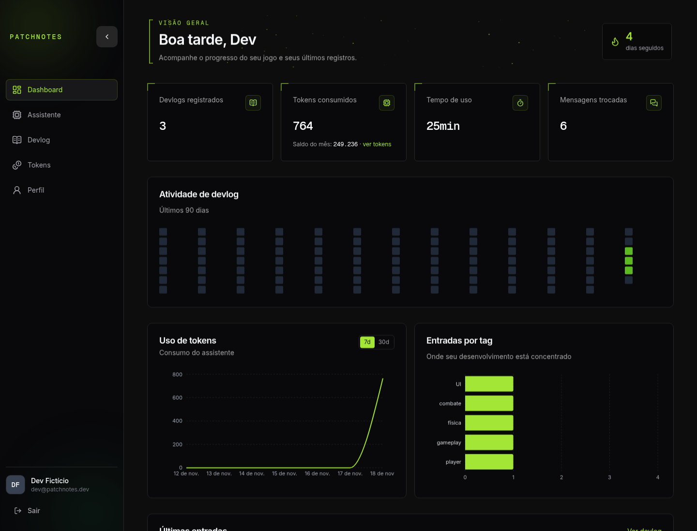
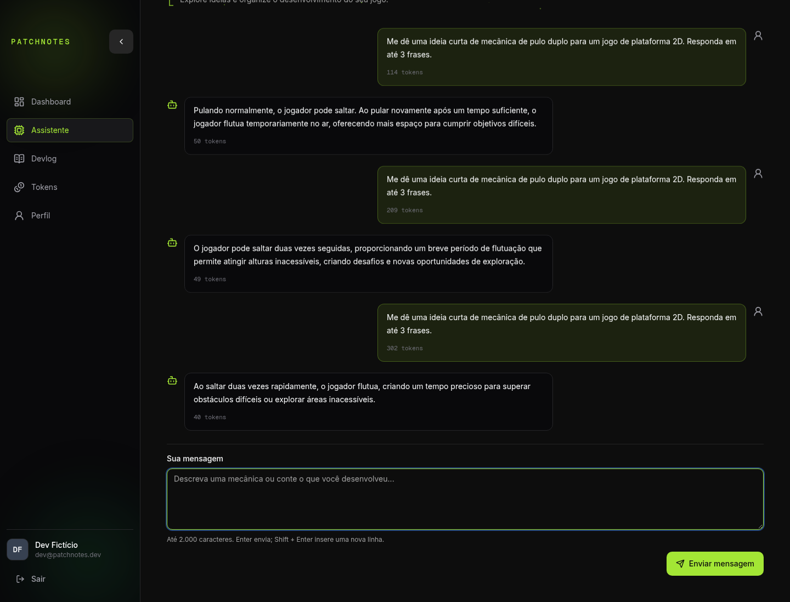
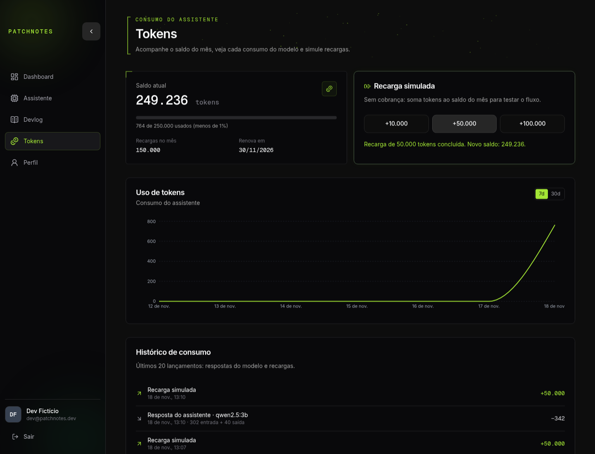
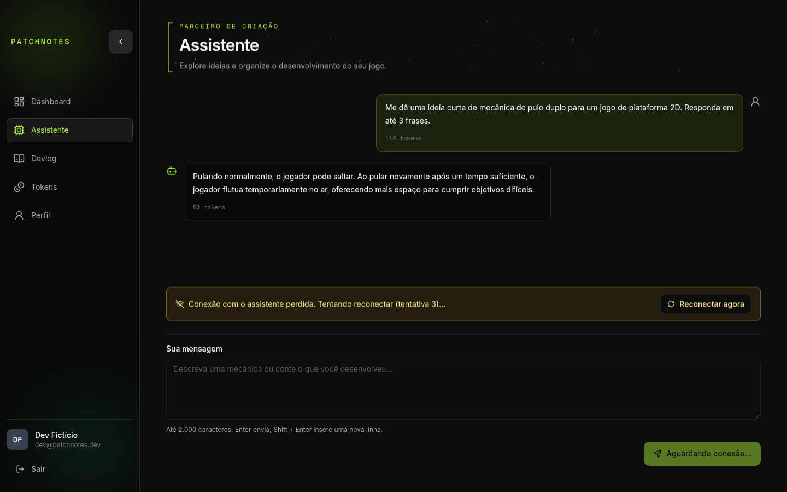
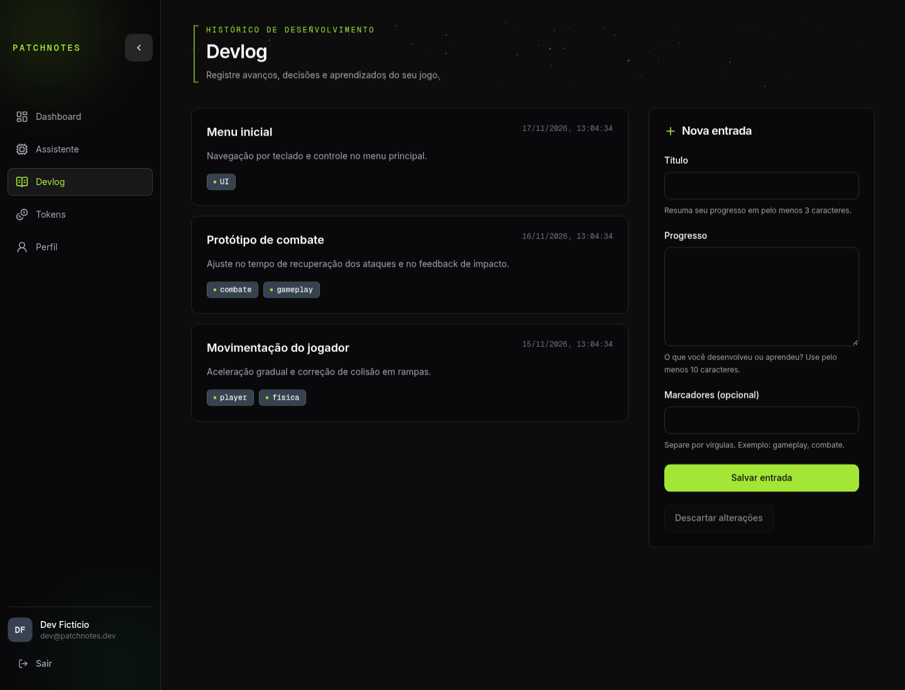
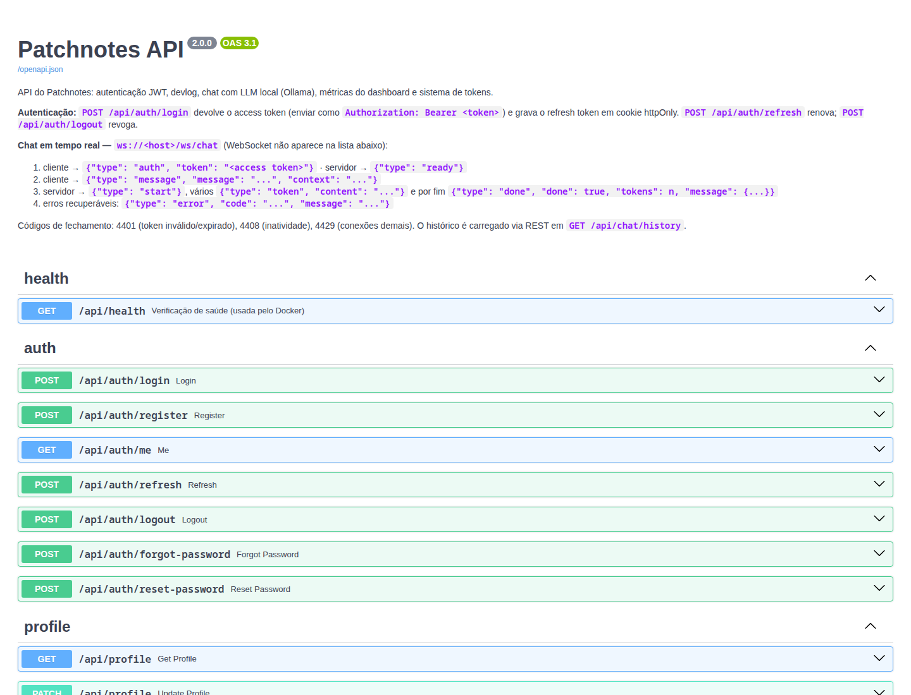

# Patchnotes

Patchnotes é um diário de bordo para quem desenvolve jogos. Num só lugar a pessoa registra o progresso em devlogs, acompanha métricas reais do projeto e conversa com um assistente (um LLM rodando localmente) para discutir mecânicas, organizar ideias e transformar o que foi feito em notas de atualização.

Este repositório junta as duas partes do projeto: o **frontend** em Next.js (Parte 1) e o **backend** em FastAPI com PostgreSQL e Ollama (Parte 2), conectados de ponta a ponta. Não há API simulada: todas as telas consomem a API real.

**Pitch (3 min):** _link do vídeo aqui_

## Telas

| Login | Dashboard |
|---|---|
|  |  |

| Assistente (streaming via WebSocket) | Tokens (saldo, extrato e recarga) |
|---|---|
|  |  |

| Aviso de queda do WebSocket (reconectando) | Devlog |
|---|---|
|  |  |



## O que o sistema faz

- Autenticação JWT de ponta a ponta: cadastro, login, renovação automática da sessão (refresh token em cookie httpOnly, rotacionado a cada uso), logout que revoga a sessão no servidor e recuperação de senha por e-mail.
- Assistente com streaming: a resposta do modelo chega token a token por WebSocket (`/ws/chat`). O campo de mensagem fica bloqueado enquanto o modelo responde, um indicador de "digitando" aparece, e se a conexão cair a tela avisa e tenta reconectar sozinha. O histórico vem do banco via REST ao abrir a tela. Cada mensagem mostra quantos tokens consumiu.
- Dashboard com dados reais: devlogs registrados, tokens consumidos (com gráfico de 7 ou 30 dias), tempo de uso, mensagens trocadas, sequência de dias ativos, heatmap de atividade e entradas por marcador.
- Sistema de tokens: saldo do mês (cota mensal + recargas − consumo), extrato com o consumo de cada resposta e as recargas, e recarga simulada em pacotes. Com o saldo zerado o chat é bloqueado (429).
- Devlog e perfil: criação e listagem de entradas com marcadores; edição de nome, bio, avatar e GitHub.
- Tratamento de erros: 401 renova a sessão ou leva ao login; 500 mostra mensagem com botão de tentar de novo; queda do WebSocket mostra aviso e reconecta.

## Stack

| Camada | Tecnologias |
|---|---|
| Frontend | Next.js 15 (App Router), React 19, TypeScript strict, Tailwind CSS, shadcn/ui + Base UI, TanStack Query, Zustand, React Hook Form + Zod, Axios, Recharts, Motion |
| Backend | Python 3.14, FastAPI (assíncrono), SQLAlchemy 2 async + asyncpg, Alembic, Pydantic v2, PyJWT, Argon2 |
| Banco e infraestrutura | PostgreSQL 17, Redis 7 (limites de requisição e de conexões), Mailpit (e-mail de desenvolvimento) |
| LLM | Ollama com `qwen2.5:3b` (local, sem chave de API) |
| Qualidade | pytest (140 testes contra PostgreSQL real), Vitest (29 testes unitários), Playwright (17 cenários ponta a ponta em Chromium, Firefox e WebKit), ESLint, `tsc --noEmit`, GitHub Actions |

## Arquitetura

Em desenvolvimento:

```text
Navegador ──HTTP /api/*──▶ Next.js (rewrite) ──▶ FastAPI ──▶ PostgreSQL
    │                                              │  ├──▶ Redis (limites)
    └──────────WebSocket ws://localhost:8000/ws/chat─▶│  └──▶ Ollama (LLM, streaming)
```

No Docker, um nginx na frente deixa tudo no mesmo endereço:

```text
Navegador ──▶ nginx :3000 ──┬── /            ──▶ Next.js
                            ├── /api/*, /docs ──▶ FastAPI
                            └── /ws/chat      ──▶ FastAPI (WebSocket)
```

- `/api/*` fica no mesmo origin do site, então o cookie do refresh token continua first-party e não é preciso CORS para o REST.
- O rewrite do Next não encaminha WebSocket. Em desenvolvimento o navegador conecta direto em `ws://localhost:8000/ws/chat`; no Docker, o nginx encaminha `/ws/chat`. O token vai na primeira mensagem, nunca na URL.
- O nginx sobrescreve o `X-Forwarded-For` com o IP de quem conectou, e a API só confia nesse cabeçalho quando vem do IP fixo do nginx (`TRUSTED_PROXIES`). Assim os limites de requisição contam o IP real de cada pessoa.
- Nenhuma conexão com o banco fica aberta enquanto o LLM gera: o pedido é gravado numa transação curta, o streaming acontece sem banco e a resposta é gravada em outra transação curta.

```text
src/                         frontend
├── app/                     rotas: (auth) login, cadastro, recuperação · (protected) dashboard, chat, devlog, tokens, perfil
├── modules/<domínio>/       components, hooks (React Query), services (Axios/WebSocket), schemas (Zod), types
├── components/              interface compartilhada (ui, efeitos, formulários)
├── lib/                     cliente Axios com renovação de sessão, configuração, cabeçalhos de segurança
├── store/                   Zustand (sessão e interface)
└── middleware.ts            proteção de rotas e Content-Security-Policy com nonce
backend/
├── app/routers/             REST (/api/...) e WebSocket (/ws/chat)
├── app/services/            regras de negócio: auth, chat, LLM, dashboard, cota e recarga de tokens, e-mail
├── app/repositories/        acesso a dados
├── app/models · schemas     tabelas SQLAlchemy e contratos Pydantic (JSON em camelCase)
├── migrations/              Alembic
└── tests/                   pytest
docs/API_CONTRACTS.md        contrato de cada endpoint e do protocolo WebSocket
```

## Como rodar

### Opção 1: tudo com Docker (recomendado)

Pré-requisitos: Docker com Docker Compose.

```bash
cp .env.example .env
# edite .env: troque JWT_SECRET e POSTGRES_PASSWORD
docker compose up --build
```

| Serviço | Endereço |
|---|---|
| Aplicação | http://localhost:3000 |
| Swagger | http://localhost:3000/docs (ou direto na API: http://localhost:8000/docs) |
| E-mails de desenvolvimento (Mailpit) | http://localhost:8025 |

Na primeira subida, o serviço `ollama-pull` baixa o modelo (cerca de 2 GB). O chat responde depois que o download termina (`docker compose logs -f ollama-pull`). Com GPU NVIDIA (e o `nvidia-container-toolkit` instalado), suba com o arquivo extra:

```bash
docker compose -f docker-compose.yml -f docker-compose.gpu.yml up --build
```

Para criar a conta de demonstração (`dev@patchnotes.dev` / `patchnotes123`, com algumas entradas de devlog):

```bash
docker compose exec backend python -m app.scripts.seed
```

### Opção 2: cada parte separada (desenvolvimento)

Pré-requisitos: Node.js 20+, Python 3.12+ (testado com 3.14), Docker (para PostgreSQL, Redis e Mailpit) e [Ollama](https://ollama.com).

**1. Banco e serviços de apoio**

```bash
cd backend
cp .env.example .env
# edite .env: defina POSTGRES_PASSWORD (a mesma em DATABASE_URL e TEST_DATABASE_URL) e gere JWT_SECRET:
#   python3 -c "import secrets; print(secrets.token_urlsafe(48))"
docker compose up -d --wait          # PostgreSQL, Redis e Mailpit em 127.0.0.1
```

**2. LLM**

```bash
ollama serve                         # se o serviço ainda não estiver rodando
ollama pull qwen2.5:3b               # ~1,9 GB; cabe numa GPU de 4 GB
```

**3. Backend**

```bash
cd backend
python3 -m venv .venv
.venv/bin/pip install -r requirements-dev.txt
.venv/bin/alembic upgrade head
.venv/bin/python -m app.scripts.seed   # opcional: conta de demonstração
.venv/bin/python -m app                # API em http://127.0.0.1:8000 (Swagger em /docs)
```

**4. Frontend** (na raiz do projeto)

```bash
cp .env.example .env                 # API_URL e NEXT_PUBLIC_CHAT_WS_URL já apontam para localhost:8000
npm install
npm run dev                          # http://localhost:3000
```

Detalhes do backend (segurança, limites, cálculo das métricas, desempenho do LLM) estão em [`backend/README.md`](backend/README.md).

## Variáveis de ambiente

- [`.env.example`](.env.example) (raiz): frontend (`API_URL`, `NEXT_PUBLIC_CHAT_WS_URL`) e as variáveis do `docker compose`.
- [`backend/.env.example`](backend/.env.example): todas as variáveis da API, comentadas (banco, JWT, Redis, SMTP, Ollama, cota de tokens, limites do WebSocket).

## API

O Swagger em **http://localhost:8000/docs** lista todos os endpoints REST, com os esquemas de entrada e saída, e descreve o protocolo do WebSocket. O contrato completo, com exemplos e códigos de erro, está em [`docs/API_CONTRACTS.md`](docs/API_CONTRACTS.md).

| Grupo | Endpoints |
|---|---|
| Auth | `POST /api/auth/register` · `login` · `refresh` · `logout` · `forgot-password` · `reset-password` · `GET /api/auth/me` |
| Chat | `GET /api/chat/history` · `POST /api/chat/send` · WebSocket `/ws/chat` |
| Dashboard | `GET /api/dashboard/metrics` · `activity-heatmap` · `token-usage?period=7d\|30d` · `entries-by-tag` · `token-balance` |
| Tokens | `GET /api/tokens/balance` · `GET /api/tokens/history` · `POST /api/tokens/recharge` |
| Devlog e perfil | `GET/POST /api/devlog/entries` · `GET/PATCH /api/profile` |

## Testes e verificações

```bash
cd backend && .venv/bin/python -m pytest -q    # requer o docker compose do backend no ar
npm run lint
npm run typecheck
npm test                 # Vitest: conexão do chat, renovação de sessão, CSP, endereço do WebSocket
npm run test:greeting
npm run build
```

### Ponta a ponta (Playwright)

Os testes em `e2e/` usam o app de verdade: cadastro, login, logout, renovação de sessão, chat com streaming, queda e reconexão do WebSocket, dashboard, tokens, recarga, devlog, perfil, erro 500, ausência de erros de console e layout de celular. Rodam em Chromium e Firefox.

```bash
npx playwright install chromium firefox        # uma vez
docker compose up -d --build                   # ou backend + frontend rodando à parte
npm run test:e2e
```

- Sem GPU, use o Ollama falso, que responde sempre o mesmo texto em streaming: `node e2e/fake-ollama.mjs` e `OLLAMA_URL=http://127.0.0.1:11434` na API.
- Outro endereço: `E2E_BASE_URL=http://localhost:3001 npm run test:e2e`. Para incluir o WebKit (Safari): `E2E_BROWSERS=chromium,firefox,webkit`.
- Cada execução cria contas novas, e o cadastro tem limite de 10 por hora por IP. Para repetir várias vezes seguidas no Docker, zere os limites com `docker compose exec redis redis-cli FLUSHALL`.

A CI (`.github/workflows/ci.yml`) roda tudo isso a cada pull request: pytest e conferência das migrations, lint, tipos, unitários e build do frontend, e o Playwright em Chromium, Firefox e WebKit com o Ollama falso.

### Navegadores

A suíte ponta a ponta completa passa em Chromium, Firefox e WebKit (motor do Safari). O fluxo principal (login, chat com streaming, tokens, navegação e logout) também foi conferido no Firefox 160 instalado no sistema, sem nenhum erro ou aviso no console.

## Segurança

Resumo das decisões em [`docs/SEGURANCA.md`](docs/SEGURANCA.md): senhas com Argon2id, refresh token rotacionado com detecção de reuso, Content-Security-Policy com nonce, limites de requisição e de conexões WebSocket no Redis, IP do cliente lido só de proxies confiáveis, e nenhum segredo no repositório.
